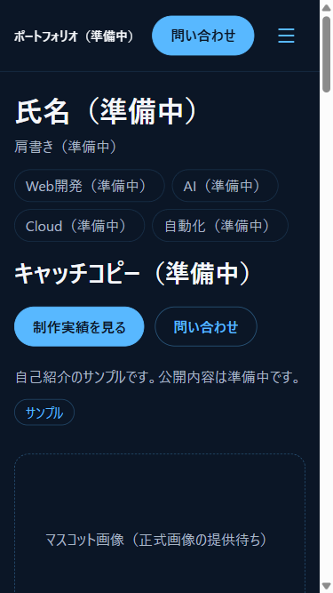
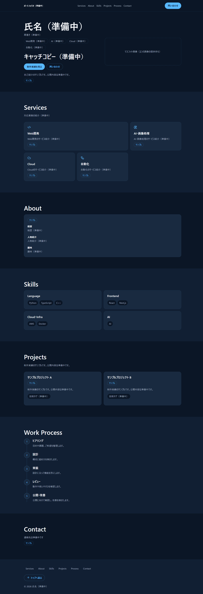

# AIのレビューで見つかった6つの問題 — Next.js × Cloudflare でポートフォリオを実装した記録

> note投稿用の下書き（第2回）。この記事の時点で、サイトは**ローカルとCIで動作を確認した段階**で、本番には公開していません。公開する情報（氏名・経歴・実績・連絡先）はすべて仮データです。

## はじめに

名刺のQRコードから開くポートフォリオサイトの実装を進めました。今回は、Claude Code が設計とコードレビューを担当し、Codex が実装を担当する体制で、実際にコードを書いています。

この記事では、作ったものよりも、**レビューで見つかった問題と、その直し方**を中心に書きます。AIが書いたコードは「テストは全部通りました」と報告されても、実際のブラウザでは動いていないことがありました。



*図1：実装済みのファーストビュー（375×667、ローカルのビルドを Playwright で撮影）。氏名などは仮データで、「サンプル」と表示されています。マスコットは正式画像が届くまで枠だけです。*

## 技術選定

| 選んだもの | 理由 |
|---|---|
| Next.js（App Router）の静的エクスポート | ログインもDBもいらない。HTMLを先に作っておけば、QRから開いたときに速い |
| Cloudflare Workers Static Assets | Workerのコードを持たない、静的配信だけの構成。攻撃される場所と運用の手間が最小になる |
| TypeScript strict | 仮データと確定データの区別を、型で強制したかった |
| Tailwind CSS | 配色をデザイントークンとして1か所で管理するため |
| Motion for React | スクロールに連動する動きが必要な部分だけで使う |

## 設計の工夫：仮データを本番に出さない仕組み

経歴や実績はまだ決まっていません。とはいえ、それっぽい架空の実績を入れて見た目を整えるのはやめました。代わりに、すべてのデータに「確定」か「仮」かの状態を持たせています。

```ts
export type ContactValue =
  | { status: 'placeholder'; value: null }
  | { status: 'confirmed'; value: string };
```

連絡先が「仮」の間は、値が `null` に決まるので、`mailto:` のリンクも vCard も作りようがありません。さらに `npm run check:content` という検査があり、仮データが1件でも残っていれば失敗します。本番公開の前には、これを必ず通すルールです。

## レビューで見つかった問題と解決

PRは6本（#22〜#26 と統合用の #2）です。Claude Code が差分を読み、問題がある行にコメントを付け、Codex が直し、もう一度レビューする、という流れを毎回回しました。

### 1. Windows で書式チェックが壊れる

CI（Linux）は通るのに、Windows で取り出したファイルだけ、Prettier の書式チェックが失敗しました。原因は改行コードです。Git の自動変換で CRLF になっていました。`.gitattributes` に `* text=auto eol=lf` を追加して解決しました。

### 2. スクリーンリーダー向けの指定が、むしろ読まれない

「サンプル」バッジに `aria-label` を付けていましたが、役割を持たない `span` に名前を付けることは ARIA で禁止されています。見えないテキスト（`sr-only`）で「（仮データ）」と読ませる方式に変えました。

### 3. 「テストは全部通る」のに、スクロールのアニメーションが動かない

一番学びが大きかったのがこれです。画面外の要素を隠しておき、スクロールで表示する `Reveal` を作りましたが、実際のブラウザでは**一度も隠れていません**でした。

単体テストは全部通っていました。テストの準備処理が「すべての要素は画面内にある」という前提になっていたため、画面外のときの処理が一度も実行されていなかったのです。さらに、テストを書き足しても、jsdom（テスト用の疑似ブラウザ）ではこの不具合を再現できませんでした。

修正では、アニメーションの制御を「待機・非表示・表示」の3つの状態に置き換えました。

```tsx
const [state, setState] = useState<'idle' | 'hidden' | 'shown'>('idle');
// マウント後、画面外にある要素だけ hidden にし、画面に入ったら shown にする
```

そのうえで、**アニメーションの確認は実ブラウザのE2Eテストで必ず行う**というルールを追加しました。

### 4. セキュリティヘッダーがアニメーションを壊す

静的なサイトではリクエストごとに nonce を発行できないため、インラインスクリプトはビルドの後でハッシュ値を計算し、Content Security Policy（CSP）に書き込む方式にしました。

ところが、`style-src 'self'` のままでは、HTML に書き出された `style="--i:0"` などの属性が14件ブロックされ、単語を順番に表示する演出が一斉表示になっていました。

`'unsafe-inline'` で全部許可するのではなく、**実際に出力された値だけ**をハッシュで許可しています。

```text
style-src-attr 'unsafe-hashes' 'sha256-…' 'sha256-…'
```

### 5. 存在しないURLのページに CSP が付いていない

CSP をページごとに出していたため、存在しない URL への応答（404ページ）には CSP が付いていませんでした。全ページのハッシュを合わせた CSP を1つだけ、全体に出す形に変えています。

### 6. 人間（とAI）の操作ミス

コードの問題以外に、作業の手順でもミスがありました。

- Issue のラベルを付けるだけのつもりが、本文を空で上書きしてしまった（すぐに復元しました）
- 作業用のファイルを、誤ってコミットに含めてしまった
- Codex への指示に誤りがあり、CI が必ず失敗する設定を入れてしまった

どれも記録に残し、同じことが起きないように、次からの指示を直しています。



*図2：デスクトップ幅でのページ全体（1440px、ローカルのビルドを Playwright で撮影）。Services のカードを2×2に配置し直す前の画面です。*

## テストの結果

テストは、実装を担当する Codex とは別のセッションを「Testing Team」として立て、仕様書からテストを設計してもらいました。結果は GitHub Actions のものです（CI run 40038369430 / 40036250539）。

| 検査 | 結果 | 確認できないこと |
|---|---|---|
| 単体テスト（Vitest + Testing Library） | 41 passed / 1 skipped（スキップは公開前のチェック） | 実際のブラウザでの挙動 |
| E2E（Playwright。本番と同じ CSP をかけた状態） | **18 passed** | Safari・Firefox・実機 |
| axe（自動のアクセシビリティ検査） | serious / critical **0 件** | WCAG への適合（自動検査だけでは判断できない） |
| Lighthouse（モバイルのエミュレーション、3 回） | Performance 0.90〜0.98、Accessibility / Best Practices / SEO 1.00、LCP 2.27〜2.43 秒、CLS 0 | 実際の利用者の環境での値（ラボでの測定） |
| 秘密情報のスキャン（gitleaks） | 漏えいなし | — |

### 6-2. 独立したテストチームが見つけた不具合

Testing Team は、スマートフォン幅のメニューボタンが「ボタン」として認識されないことを見つけました。HTML の `<details>` / `<summary>` で、JS がなくても開閉できるメニューにしていたのですが、`<summary>` はアクセシビリティの上ではボタンとして扱われないことがあります。

最初の修正（CSS の調整）では直らず、CI の E2E が引き続き失敗しました。最終的に、`aria-expanded` を持つ本物の `<button>` に作り替えています。「直したつもり」をテストが客観的に否定してくれた例です。

## これから

- オーナーが PR を確認してマージする（本番デプロイはその後、承認を得てから）
- 氏名・経歴・実績・連絡先を確定し、`check:content` を通す
- マスコットの正式画像を受け取って、枠を差し替える
- 第3回では、Claude Code と Codex の役割分担と、レビューの運用を詳しく書く予定です

---

※公開前に更新：マージの状況、本番URL（公開後のみ）、テスト結果、実機での確認。未実施の検証を実施済みと書かない。
