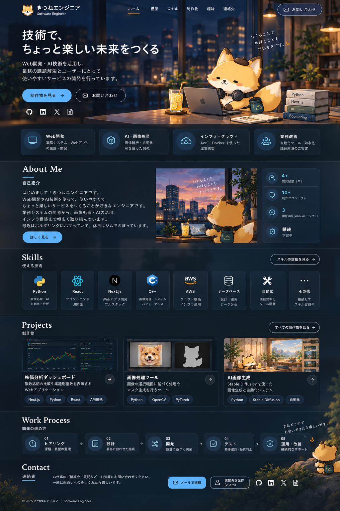
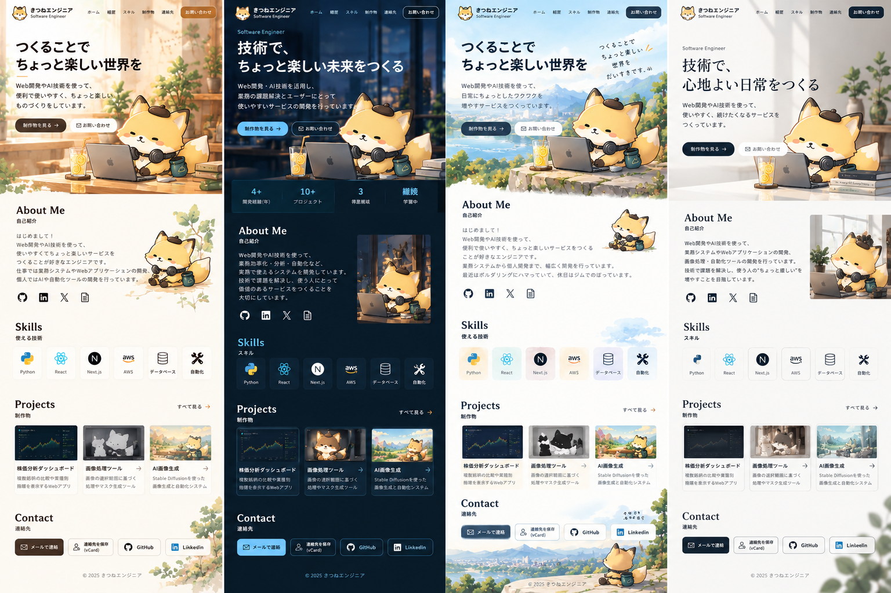

# 名刺のQRコードから始まる、動きのあるエンジニアポートフォリオを設計するまで

> note投稿用の下書き。公開前に実装状況・技術選定・スクリーンショット・成果を事実確認してください。現段階は**設計フェーズ**です。

## はじめに

名刺交換のあと、自分がどんなエンジニアで、何を作れて、どんな仕事を相談できるのか。短い時間でも伝わる場所が欲しくなりました。

そこで、名刺にQRコードを載せ、スマートフォンから開けるポートフォリオサイトを作ることにしました。目指したのは「かわいい自己紹介サイト」ではなく、親しみやすさと営業で使える信頼感を両立したWebサイトです。

## デザインは「ダークネイビー × 親しみやすさ」

複数の案を比較し、最終的にダークネイビーを基調としたモダンな方向性を選びました。アクセントはライトブルー。情報を整理したカードと余白で、技術や実績が読み取りやすい設計にしています。

一方で、サイトの個性としてオリジナルのきつねのマスコットを採用。ベレー帽、ヘッドホン、チョークバッグ、レモネードという要素を統一し、デザインが変わっても同じキャラクターとして見えるようにしています。

*図1：採用したダークネイビーのデザインコンセプト。AIで作成した参考画像であり、実装済み画面のスクリーンショットではありません。*

*図2：方向性を検討した4案の比較。2案目のダークビジネス系をベースとして選択しました。*

## UXで最優先したこと

QRコードから訪問する人は、長い説明を読むとは限りません。そこでファーストビューで「誰か」「何ができるか」「どう連絡できるか」が分かる構成にしました。制作実績と問い合わせの導線も、迷わず見つけられるように設計しています。

## 動きは、目的がある場所だけ

Heroの文字の登場、Bento Gridのカード表示、制作実績のスクロール演出などを取り入れる予定です。ただし、スクロール操作を奪う演出や重い3Dは採用しません。`prefers-reduced-motion` に対応し、動きが苦手な人にも使いやすいサイトを目指します。

## 技術構成：Next.jsとCloudflare

フロントエンドはNext.js App RouterとTypeScript。初期版は静的エクスポートを前提に、Cloudflare Workers Static Assetsで配信する設計です。ログインやデータベースは最初から持たず、必要になった時点で見直します。

## AIを使うからこそ、レビューを分ける

開発フローはClaude Codeが設計管理と**正式なコードレビュー**を担当し、Codexが実装とテストを担当する形を想定しています。

ここで大切にしたいのは、AIが「実装しました」と言ったことと、品質が確認できたことは別だという点です。要件にIDを付け、実装ファイル、テスト、レビュー記録を結びつけます。レビューでは、指摘内容・重大度・修正コミット・再検証結果を残す方針です。

**開発フローの図は実際のGitHub Actions構成・レビュー運用を確認後に追加予定です。** 実際に稼働していない仕組みを図で稼働済みとして示さないようにします。

## セキュリティとアクセシビリティを後回しにしない

TypeScript strict、Lint、テストに加え、OWASP ASVSの適用可能な項目、WCAG 2.2 AA、セキュリティヘッダー、秘密情報管理などを設計に含めました。これらは現時点で**達成済みという意味ではありません**。実装後に検証し、結果を残していきます。

## これから

まずはスマートフォン向けの静的な画面を作り、次にモーションを加え、最後にアクセシビリティとパフォーマンスを検証する予定です。完成画面だけでなく、設計判断やレビューで見つかった改善点も記録していきたいと思います。

次回は、実際のコンポーネント構成とClaude Code・Codexの役割分担について紹介する予定です。

---

※公開前に更新：実装済み機能、実測スコア、利用したツールの接続方法、公開URL、スクリーンショット。未実施の検証を実施済みと書かない。
