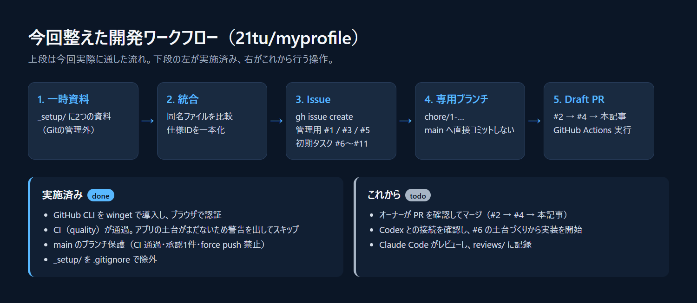

# コードを書く前に、AIと一緒に「開発の流れ」を整えた話

> note投稿用の下書き（番外編）。この記事の時点で、ポートフォリオサイトのアプリのコードはまだ1行もありません。書いてあるのは、GitHub上の開発の流れを整えた作業と、これからの予定です。

## はじめに

名刺のQRコードから開くポートフォリオサイトを作っています。デザインとUXの方針は、連載の第1回にまとめています。

いざ実装に入る前に、もう一つ用意しておきたいものがありました。**「誰が何を作り、誰が確認して、いつ本番に出すのか」という開発の流れ**です。

このプロジェクトでは、AIのClaude Codeに設計管理とコードレビュー、同じくAIのCodexに実装を任せる予定です。AIに作業を任せるほど、「何を根拠に完成と言えるのか」を先に決めておかないと、あとから追いかけられなくなります。

今回はその土台づくりを、Claude Codeと一緒に進めた記録です。



*図1：今回整えた開発の流れ。上段は実際に通した流れ、下段の左が実施済み、右がこれから行う操作です。Claude Codeが作った図で、アプリの画面ではありません。*

## 用意していた2つの資料

作業前の手元には、別々に用意した2つの資料がありました。

- **portfolio-spec**：要件・設計の仕様書、ADR（設計判断の記録）、コードレビューのチェックリスト、note記事の下書き
- **myprofile-workflow**：GitHubのIssue/PRテンプレート、品質チェック用のGitHub Actions、Issueを一括作成するスクリプト

この2つを、リポジトリの `_setup/` フォルダに一時的に置きました。最終的な置き場所ではないので、Gitには入れません（`.gitignore` で除外）。

## 「上書きしないで、比べて統合する」

Claude Codeへの依頼で一番気をつけたのは、**同名のファイルを無条件に上書きしない**ことです。

比べてみると、片方を捨てるわけにはいかない違いがいくつも見つかりました。

- `README.md`、`CLAUDE.md`、`AGENTS.md`、PRテンプレートが両方の資料にあった
- **仕様IDが衝突していた。** 例えば `FR-003` が、片方では「ページのセクション構成」、もう片方では「問い合わせ」を指していた
- レビュー指摘の重大度が、4段階（BLOCKER/HIGH/MEDIUM/LOW）と3段階（BLOCKER/MAJOR/MINOR）で違っていた
- レビュー記録やADRの保存場所が、資料によって違っていた

特に仕様IDの衝突は放っておけません。このプロジェクトでは「仕様ID → 実装 → テスト → レビュー」をIDでつなぐ方針なので、同じIDが2つの意味を持つと、つながり自体が成り立たなくなります。

そこで次のように決めました。

- より詳しい `docs/requirements.md` のIDを正とする
- もう片方にしかない要件（配色、マスコットの一貫性、CI、レビュー記録など）は新しいIDで追加する
- 古いIDから新しいIDへの**対応表**を仕様書に残す
- 重大度は3段階、保存場所も1か所ずつに揃える

`CLAUDE.md` や `AGENTS.md` は、日本語版を土台に、もう片方にしかなかったルールを足していく形で一つにまとめました。

## GitHub CLIの導入と、ちょっとしたつまずき

次に、GitHub CLI（`gh`）でIssueとPRを作ります。ところが、そもそも `gh` がPCに入っていませんでした。

- Claude Codeが Windows のパッケージ管理ツール winget で `gh` をインストールした
- GitHubへのログインは、ブラウザに表示されたワンタイムコードを入力するデバイス認証で行った

ここで2回つまずきました。

1. **シェルの違い。** Claude Codeでは、行頭に `!` を付けると自分でコマンドを実行できます。このとき使われるのはbashでした。PowerShell向けに `&` を付けたコマンドを渡したところ、構文エラーになりました。
2. **認証待ちでタイムアウト。** デバイス認証はブラウザでの操作が終わるまで待ち続けるので、コマンドが時間切れになってバックグラウンドに回りました。ブラウザで認証を済ませたら、無事に完了しました。

もう一つ、**gitのユーザー名とメールアドレスが未設定**で、最初のコミットが失敗しました。最初のコミットと同じ作成者を、このリポジトリだけの設定として登録して解決しています。

どれも小さなことですが、AIに任せていると気づきにくい部分です。Claude Codeが失敗をそのまま報告してくれたので、どこで止まったのかが分かりました。

## Issue → 専用ブランチ → Draft PR

いよいよ本題の流れです。今回のルールは3つだけです。

- 作業の前に必ずIssueを作る
- `main` ブランチへ直接コミットしない
- PRはDraft（下書き）で出し、マージと本番デプロイは人間が判断する

実際に作ったものは次のとおりです。

| 種類 | 番号 | 内容 |
|---|---|---|
| Issue / PR | #1 / #2 | 2つの資料の統合 |
| Issue / PR | #3 / #4 | note記事の作成手順書 |
| Issue | #5 | この記事 |
| Issue | #6〜#11 | 初期タスク（土台づくり、UI、モーション、セキュリティ、QA、ドキュメント） |

ブランチ名はIssue番号から始めています（例：`chore/1-integrate-setup-docs`）。PRの本文には `Closes #1` のように書き、どのIssueのための変更かが分かるようにしました。

初期タスクの6件は、資料に入っていたスクリプト `scripts/create-issues.sh` で作りました。同じタイトルのIssueが既にあれば作らない仕組みなので、間違って2回実行しても重複しません。

## CIは「まだ何も検査していない」ことを正直に出す

PRを出すと、GitHub Actionsの品質チェック（quality）が動きます。結果は**通過**でした。

ただし、この「通過」には注意が必要です。アプリのコード（`package.json` など）がまだないので、品質チェックは「Next.jsの土台がない」という警告を出して、検査を**スキップ**しています。

つまり、この時点で緑のチェックマークが付いていても、コードの品質が確認できたわけではありません。仕組みとして、「何も検査していないのに合格に見える」状態を警告ではっきり示すようにしています。土台づくりのIssue（#6）が終わってから、本当の検査が始まります。

## mainを守るブランチ保護

最後に、`main` ブランチに保護をかけました。

- 品質チェック（quality）が通らないとマージできない
- ブランチが最新の `main` を取り込んでいないとマージできない
- 承認（Approve）が1件以上ないとマージできない
- 新しいコミットを積むと、それまでの承認は取り消される
- PR上の議論がすべて解決済みでないとマージできない
- 強制プッシュ（force push）とブランチの削除を禁止する

一人で開発していることによる制約もありました。GitHubでは**自分のPRを自分で承認できません**。そのため、管理者である自分だけは、この制限を確認したうえで飛ばしてマージできる設定にしています。代わりに「Claude Codeのレビュー記録が残っていることを確認してからマージする」というルールで補います。

## これからの操作

ここからは予定です。まだ実施していません。

### 1. PRを確認してマージする（人間）

順番は #2 → #4 → この記事のPR です。後ろのPRは前のPRの上に積んでいるので、順番が大事です。

```bash
gh pr ready 2                     # 下書きを解除する
gh pr merge 2 --merge --admin     # 管理者として保護を飛ばしてマージする
```

マージ方式は squash ではなく、通常のマージ（`--merge`）にする予定です。レビュー記録にはコミットのSHAを書くので、コミットがまとめ直されるとSHAが変わり、記録とつながらなくなるからです。

### 2. Codexとの接続を確認する

実装を担当するCodexを、Claude Codeから呼び出せるかを最初に確認します。Claude Code向けのルール（`CLAUDE.md`）には「接続手段を推測しない。使えなければブロッカーとして報告する」と書いてあるので、ここは実際に試して確かめます。

### 3. 土台づくり（#6）から実装を始める

Next.js App Router、TypeScript strict、Cloudflare Workers Static Assets の土台を作ります。`package.json` ができた時点で、品質チェックが本当に動き始めます（フォーマット、Lint、型チェック、テスト、ビルド、依存関係の監査）。

### 4. Claude Codeが正式にレビューし、記録を残す

CodexのPRに対して、Claude Codeが実際の差分を読み、行単位でコメントします。重大度（BLOCKER/MAJOR/MINOR）、仕様ID、修正案を付けて、`reviews/` にレビュー記録を残します。BLOCKERやMAJORが残っている限り、承認しません。

### 5. 次の記事を書く

土台づくりが終わったら、第2回「Next.js × Cloudflareの構成と静的配信」を書く予定です。

## おわりに

今回、アプリのコードは1行も書いていません。それでも、「何を根拠に完成と言うか」を決めて仕組みにしておくと、AIに作業を任せても後から追いかけられるという安心感があります。

特に良かったのは、Claude Codeが**できなかったことを、できなかったと報告してくれた**点です。CLIがない、ログインできていない、コミットに失敗した。そうした報告がそのまま残っているので、この記事も記録をたどりながら書けました。

---

※公開前に更新：PRのマージ状況、Codexとの接続結果、本文中の「予定」が実施済みになったかどうか。未実施の検証を実施済みと書かない。
